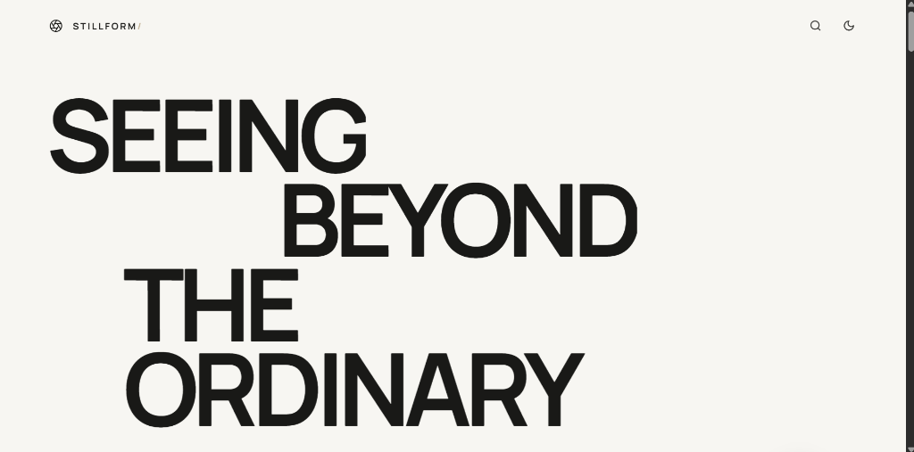
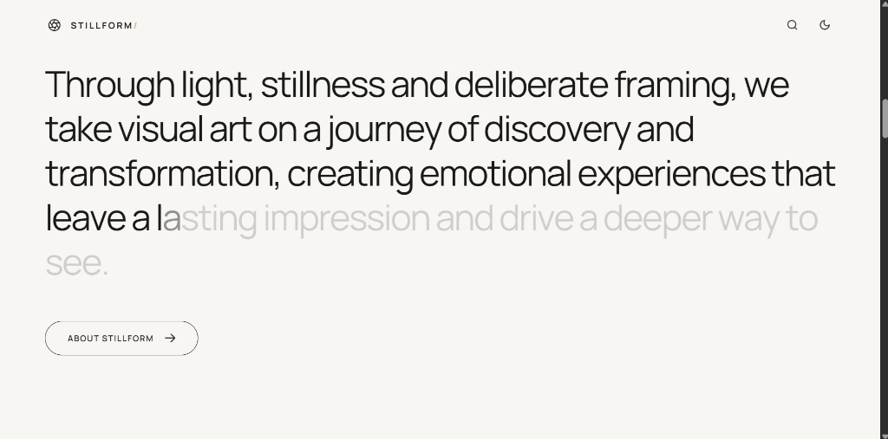
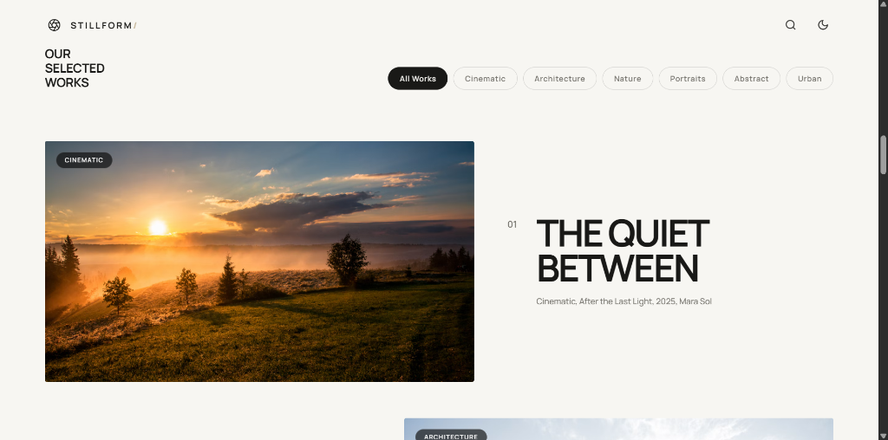

<div align="center">


# STILLFORM

*An editorial cinematic visual archive engineered with fluid kinetic typography and scroll-driven storytelling.*

[](https://react.dev/)
[](https://www.typescriptlang.org/)
[](https://vitejs.dev/)
[](https://greensock.com/gsap/)
[](LICENSE)

</div>

---

## Overview

**STILLFORM** is a digital curation platform designed to celebrate cinema-grade photography, modernist architectural forms, and deliberate visual stillness. Inspired by the editorial design language of high-end design ateliers like [Outpost](https://outpost.design/), the interface prioritizes visual impact, fluid motion, and distraction-free viewing.

---

## Visual Showcase

### 1. Kinetic Typography & Bodyless Navigation
The hero features staggered kinetic typography with multi-plane parallax drift, paired with a floating, bodyless header that preserves complete transparency over the viewport.

<p align="center">
  
</p>

### 2. Scroll-Driven Character Typing Reveal
As the user scrolls into the editorial statement, each letter progressively transitions from a muted ghost gray into rich, solid ink character by character—mirroring real-time typewriter scrub dynamics.

<p align="center">
  
</p>

### 3. Selected Works Showcase & Curatorial Filters
An alternating project layout with interactive category pill filtering, smooth media zoom on hover, and direct metadata cues.

<p align="center">
  
</p>

---

## Key Features

- **Bodyless Floating Navigation**: Completely transparent header without background boxes, frosted glass pills, or dividing borders. Clicks pass through empty regions to content beneath.
- **Scroll-Triggered Image Zoom**: The hero artwork begins anchored on the left (`scale: 0.72`) and naturally expands into full width as you scroll, without shifting over headlines.
- **Typewriter Statement Scrub**: Character-by-character GSAP ScrollTrigger animation transitioning letters from faint ghost gray to solid black/white ink.
- **Accessible Text Segmentation**: Words are preserved as unbreakable inline blocks (`white-space: nowrap`) with standard whitespace wrapping, supplemented by full-sentence `aria-label` tags for screen readers.
- **Curated Category Curation**: Initial "All Works" view maintains an editorial 5-item showcase; clicking category filters (`Cinematic`, `Architecture`, `Nature`, `Portraits`, `Abstract`, `Urban`) reveals full archives.
- **Fullscreen Lightbox**: Keyboard-accessible modal with full-resolution imagery, metadata inspection, counter index, and `ArrowLeft`/`ArrowRight`/`Escape` navigation.
- **Synchronized Dual Theme**: Seamless dark mode (`#0b0b0b`) and light mode (`#f7f6f2`) with automatic system preference detection and localStorage persistence.
- **Motion Accessibility**: Built-in `prefers-reduced-motion` safety checks automatically bypass kinetic transforms for users with motion sensitivity.

---

## Tech Stack

| Layer | Technology | Purpose |
|---|---|---|
| **Framework** | [React 18](https://react.dev/) | Component architecture & state synchronization |
| **Language** | [TypeScript 5](https://www.typescriptlang.org/) | Strict type checking & API contracts |
| **Animation** | [GSAP 3](https://greensock.com/gsap/) + [ScrollTrigger](https://greensock.com/scrolltrigger/) | GPU-composited timelines, scrub mechanics & stagger |
| **Styling** | Vanilla CSS Tokens | Zero runtime CSS overhead, native custom properties |
| **Icons** | [Lucide React](https://lucide.dev/) | Clean geometric vector iconography |
| **Bundler** | [Vite 6](https://vitejs.dev/) | Instant HMR development server & optimized rollup production |

---

## Project Structure

```text
stillform/
├── docs/
│   └── assets/
│       ├── logo.svg              # Adaptive dark/light logo SVG
│       ├── logo-mark.png         # Aperture shutter mark
│       ├── hero.png              # Hero & kinetic typography preview
│       ├── statement-reveal.png  # Character reveal preview
│       └── selected-works.png    # Selected works preview
├── public/
│   └── logo.svg                  # Favicon & browser vector asset
├── src/
│   ├── data/
│   │   └── gallery.ts            # Curated artwork & collection records
│   ├── App.tsx                   # Core application layout & GSAP timelines
│   ├── main.tsx                  # Application mount point
│   └── styles.css                # Design tokens, typography & animations
├── index.html                    # HTML5 shell & Google Fonts configuration
├── package.json                  # Dependencies & execution scripts
├── tsconfig.json                 # TypeScript compiler configuration
└── vite.config.ts                # Vite build configuration
```

---

## Getting Started

### Prerequisites
- Node.js 20+ installed
- pnpm (or npm / yarn)

### Installation
```bash
git clone https://github.com/your-username/stillform.git
cd stillform
pnpm install
```

### Development Server
Start the local development server with instant Hot Module Replacement:
```bash
pnpm dev
```
Open [http://localhost:5173](http://localhost:5173) in your browser.

### Production Build
Type-check and generate minified production bundles:
```bash
pnpm build
```

Preview the production build locally:
```bash
pnpm preview
```

---


## License

Released under the [MIT License](LICENSE).
